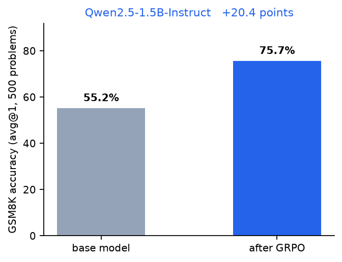
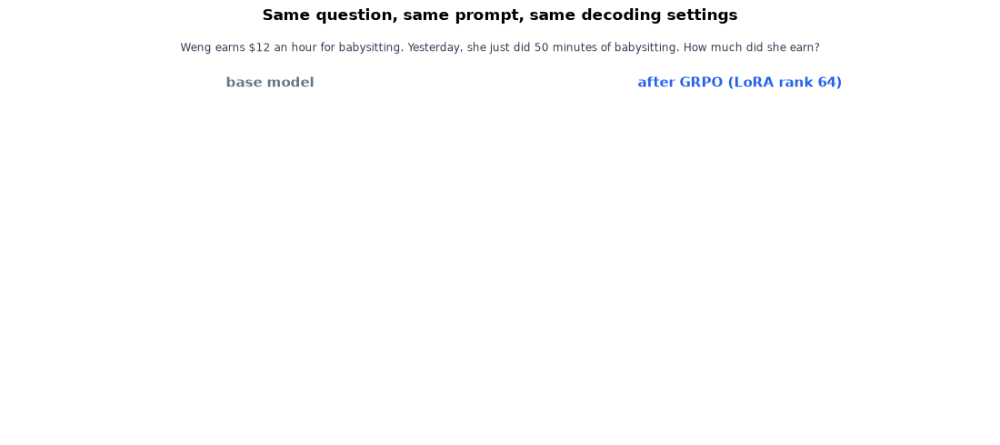
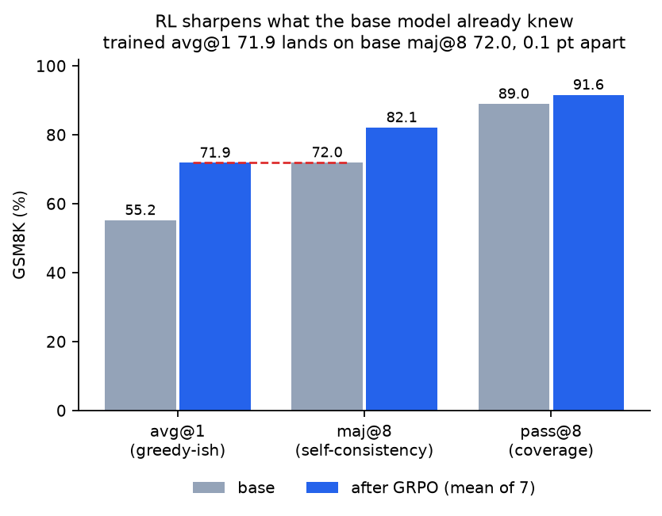
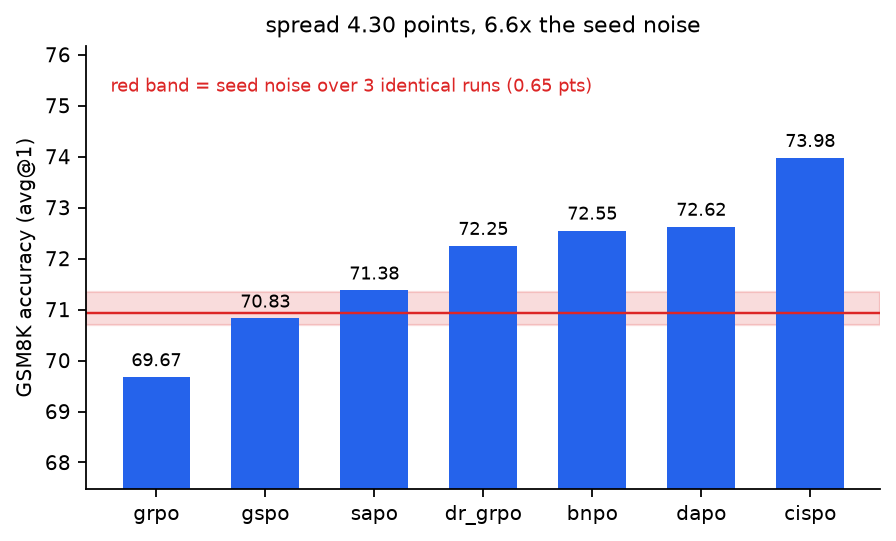
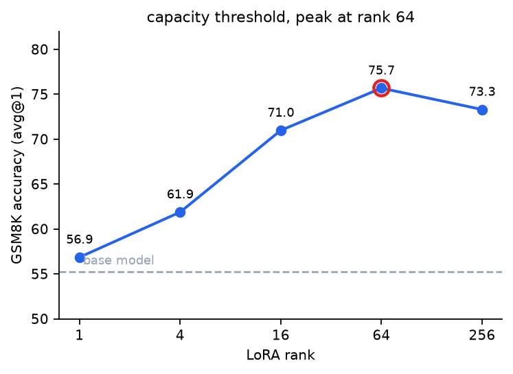
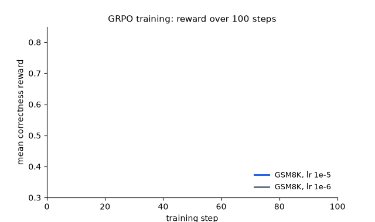
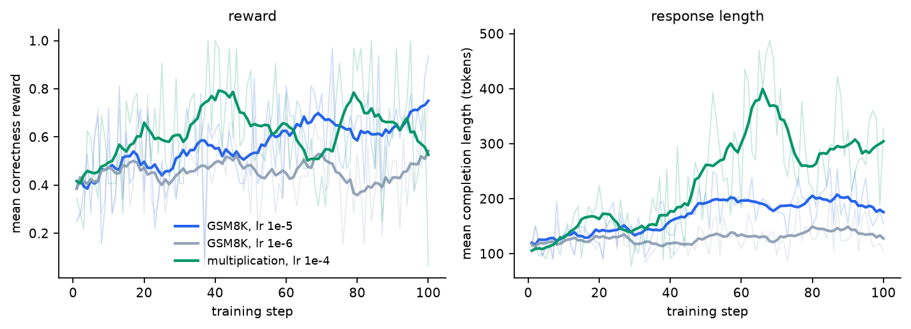
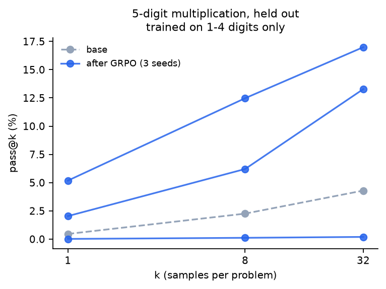

# grpo-math

Reinforcement learning with verifiable rewards (RLVR) on a 1.5B language model, from scratch, on one GPU.

GRPO training of `Qwen2.5-1.5B-Instruct` on GSM8K grade-school math, plus the controls that tell you
whether a result is real: a seed noise floor, a LoRA rank ladder, seven policy-gradient variants, and
one honest negative result.



**GSM8K accuracy 55.25% to 75.67%, +20.4 points**, measured on 500 held-out problems, 8 samples each,
with an exact-match numeric grader.

### The same question, before and after



Both models reason correctly here. The base model ends with `<answer>10 dollars</answer>`, which an
exact-match grader rejects, while the trained model ends with `<answer>10</answer>`.

That is worth being honest about: part of the gain is answer discipline, not new math. A looser
symbolic grader scores the base model 57.30 instead of 55.25, so roughly 2 of the 20 points are
formatting. The other 18 are not.

---

## What RLVR is, in one paragraph

Supervised fine-tuning teaches a model to imitate reference solutions. RLVR skips the references: the
model samples its own answers, a program checks whether each final answer is correct, and correct
samples are reinforced. There is no reward model and no human labels, only a verifier. GRPO (Group
Relative Policy Optimization) is the policy-gradient algorithm that does this without a learned value
network: it draws a group of completions per prompt and uses the group's mean reward as the baseline.
That makes the whole loop cheap enough to run on a single consumer GPU, which is the point of this repo.

## Quickstart

Colab, free T4, no setup:

```
open colab.ipynb in Google Colab, Runtime > Run all
```

Local, one command, resumable:

```bash
pip install -r requirements.txt
./run_all.sh
```

`run_all.sh` skips any training run or evaluation that already finished, so it is safe to interrupt and
restart. It writes `results/*.jsonl`, regenerates `figures/*.png`, and prints every table below.

Single pieces:

```bash
python train.py --name my_run --loss-type grpo --lr 1e-5 --lora-r 64 --steps 100
python evaluate.py --model runs/my_run/final --tag my_run --dataset gsm8k --n 8 --limit 500
```

---

## Results

### 1. GRPO sharpens what the base model already knew



This is the most interesting result in the repo and the one that changed how I read RL papers.

Three ways to measure the same model:

- **avg@1** is accuracy on a single sample, what people usually quote.
- **maj@8** samples 8 times and takes the majority answer (self-consistency).
- **pass@8** counts a problem solved if *any* of 8 samples is right, so it measures coverage.

Averaged over the seven trained variants, **trained avg@1 is 71.90 and base maj@8 is 72.00**. RL moved
single-sample accuracy to almost exactly where the base model's own majority vote already was.
Meanwhile pass@8 barely moved, 89.00 to 91.6.

So GRPO mostly concentrated probability onto answers the base model could already produce, rather than
teaching it to solve problems it previously could not. If you only report avg@1 you will call that
"learning to do math." The pass@k column is what keeps you honest.

### 2. The seed noise floor, measured before trusting anything

Three runs, identical in every way except the random seed:

| seed | avg@1 % |
|---|---|
| 0 | 71.35 |
| 1 | 70.70 |
| 2 | 70.75 |

**Spread 0.65 points, standard deviation 0.36.** Every comparison below is read against this number.
Without it, a 1-point difference looks like a finding; with it, you know a 1-point difference is noise.

### 3. Seven policy-gradient variants are not interchangeable



| variant | avg@1 % | maj@8 % | tokens |
|---|---|---|---|
| cispo | 73.98 | 82.60 | 193 |
| dapo | 72.62 | 82.20 | 185 |
| bnpo | 72.55 | 82.40 | 192 |
| dr_grpo | 72.25 | 81.40 | 173 |
| sapo | 71.38 | 83.40 | 165 |
| gspo | 70.83 | 82.40 | 201 |
| grpo | 69.67 | 80.60 | 158 |

All seven share the same data, learning rate, adapter, and step count, differing only in the loss. The
spread is **4.30 points, 6.6x the seed noise**, so the ordering is not an artifact. CISPO's clipped
importance-sampling objective comes out ahead of vanilla GRPO by 4.3 points here.

One caveat worth stating: this is a single seed per variant at one model scale on one dataset. The gap
is larger than noise, but "cispo is the best RL algorithm" is not what this shows.

### 4. LoRA rank is a capacity threshold, not a tuning knob



| LoRA rank | avg@1 % | maj@8 % | pass@8 % | vs base |
|---|---|---|---|---|
| 1 | 56.85 | 73.40 | 87.80 | +1.60 |
| 4 | 61.88 | 81.20 | 90.00 | +6.63 |
| 16 | 70.97 | 80.40 | 90.80 | +15.72 |
| 64 | 75.67 | 83.40 | 93.80 | +20.43 |
| 256 | 73.30 | 78.60 | 89.00 | +18.05 |

Rank 1 gains only **+1.60 over base**, against a 0.65 noise floor: the adapter is too small to hold
the update. Accuracy climbs steeply to rank 64, then falls back at 256. Rank 64 also has the best coverage
in the whole repo, the only configuration to move pass@8 meaningfully off the base model's 89.0.

### 5. Learning rate is the setting that decides whether anything happens at all

| learning rate (rank 16) | avg@1 % |
|---|---|
| no training | 55.25 |
| 1e-6 | 55.93 |
| 1e-5 | 70.97 |

At 1e-6 the model finishes **0.68 points above base, the same size as the 0.65 noise floor**: 100
steps of RL that changed nothing. One order of magnitude on the learning rate is the difference between a null result
and +15.7.

This is also a trap worth knowing about. Compare algorithms at a learning rate that does nothing and
they will all tie, and you will conclude the choice of algorithm does not matter. It does, as section 3
shows, but only once the optimizer is actually moving.

### 6. Training dynamics





Reward climbs and responses get longer without any length reward, a commonly reported RLVR effect. The
1e-6 run is flat in both panels, which is the same null result as the table above seen from the
optimizer's side.

---

## A negative result: teaching multiplication by curriculum did not generalize



The experiment: train only on 1-to-4-digit multiplication with an exact-match reward, then test on
**5 and 6 digits, never seen in training**. If RL taught an algorithm rather than a lookup table, it
should extrapolate.

| held out | metric | base % | GRPO % (3 seeds) | best seed % |
|---|---|---|---|---|
| 5-digit | pass@1 | 0.46 | 2.41 ± 2.6 | 5.18 |
| 5-digit | pass@32 | 4.30 | 10.16 ± 8.8 | 16.99 |
| 6-digit | pass@1 | 0.02 | 0.10 ± 0.1 | 0.24 |
| 6-digit | pass@32 | 0.39 | 0.59 ± 0.7 | 1.37 |

It improves, and the improvement is unreliable: **one of the three seeds collapsed to 0.20% on 5-digit,
below the base model**, which is the flat line in the figure. The standard deviation is nearly as large
as the mean. Six digits never works at all.

I also tested whether this was a compute problem, and it is not. Quadrupling the group size and
quadrupling the step count both failed to beat the 100-step run, and the long run hit the 1024-token
generation cap, meaning it was learning to write longer rather than to carry digits correctly.

Reported here because a repo that only shows what worked is not evidence of much.

---

## What to take away

1. **Measure your noise floor first.** Three identical seeds cost 17 minutes and determine which
   differences in the rest of the repo mean anything.
2. **avg@1 alone will mislead you.** Track pass@k, or you cannot distinguish a model that learned
   something new from one that got more confident about what it already knew.
3. **Learning rate dominates algorithm choice.** Verify the optimizer is moving before comparing losses.
4. **LoRA rank has a floor.** Below it, nothing trains; far above it, results get slightly worse.
5. **Negative results need seeds.** One multiplication seed looked like a win; three showed it was not.

## Repo layout

```
tasks.py       datasets, answer extraction, exact-match grading
rewards.py     reward functions (correctness, format bonus)
train.py       GRPO training, colocated vLLM generation, optional LoRA
evaluate.py    avg@1 / maj@k / pass@k, merges LoRA adapters for inference
plots.py       regenerates every figure from results/
checkpoints/   LoRA adapters, git-ignored for size, see checkpoints/README.md
report.py      regenerates every table from results/
run_all.sh     the whole thing, resumable
colab.ipynb    free-tier T4 notebook
results/reference/   committed metrics from the run that produced this README
results/             where your own run writes, read in preference to reference/
```

## Reproducing

Every number above comes from `results/reference/*.jsonl`, which is committed. Regenerate the figures
and tables from it without a GPU:

```bash
python plots.py && python report.py
```

Full reproduction is **2.5 hours of training wall-clock** across 20 runs on one RTX PRO 6000, plus
evaluation. On a free Colab T4 expect roughly 4 to 6x that, so two or three sessions; `run_all.sh`
resumes, so you can stop and restart it.

Evaluation protocol throughout: 500 held-out GSM8K problems, 8 samples at temperature 0.6, 640-token
cap, exact numeric match on the contents of `<answer>` tags with a last-number fallback. Multiplication
uses 512 held-out problems and 32 samples.

## Notes

- Model: `Qwen/Qwen2.5-1.5B-Instruct`. Data: GSM8K, and synthetic multiplication generated in `tasks.py`.
- `train.py` colocates vLLM with the trainer in one process, which is what makes 100 GRPO steps take
  about 5 minutes here instead of an hour.
- `VLLM_USE_FLASHINFER_SAMPLER=0` is set in `train.py`; the FlashInfer sampler tries a very large
  warmup allocation on some setups.
